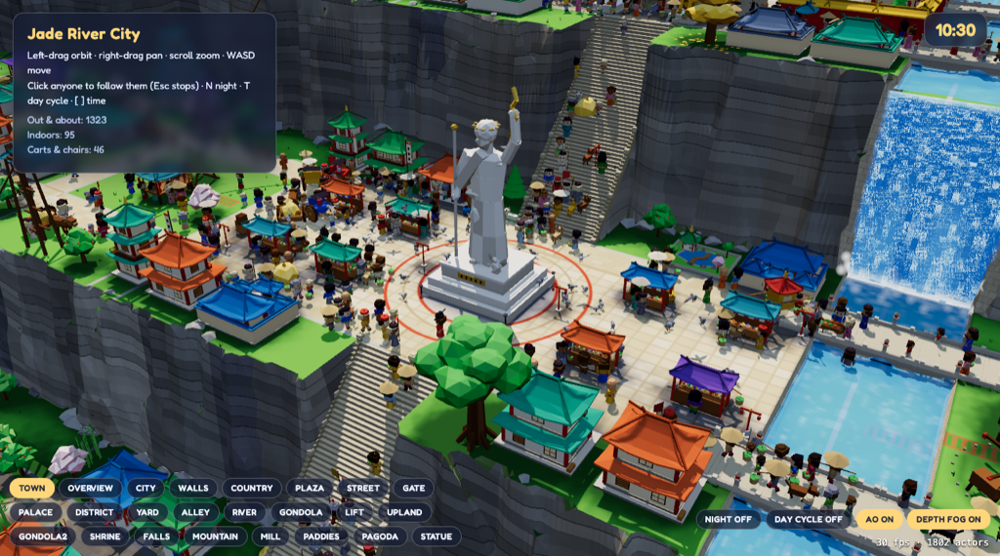

# Jade River City

A living city simulation in the browser: thousands of little people run errands, ride gondolas and cargo lifts, and crowd the market of a walled mountain city, all built with three.js.

**Live:** [low-poly edition](https://waldo-polygon.akwiat.com) · [voxel edition](https://waldo-voxel.akwiat.com)



## What it is

It started as a pixel-art "spot the hidden characters" crowd scene and grew into a city sim. Every citizen has a home and a role, and they move around a street graph doing errands: shopping at market stalls, visiting shops, inns and friends, working the rice paddies outside the gate, and going in and out of doors. Routing avoids congestion, and crowds keep right and steer around each other. You can click anyone to follow them.

The repo holds several editions, newest first:

| Path | What |
|---|---|
| [`polygon/`](polygon/) | **Low-poly edition**, the current one. The voxel mountain city rebuilt with flat-shaded polygons, with a full day/night cycle (dawn, noon, sunset, night) |
| [`voxel/`](voxel/) | **Voxel edition**. A 3D city cut into a mountain on terraced cliffs, with a river and waterfalls, a palace, a giant statue in the market square, gondolas, cargo lifts and airships. Buildings are voxel models generated from code recipes |
| `index.html` | **2D pixel edition**. The original city sim in a 16-bit RPG style: a walled riverside city with guards, patrols, vehicles, pets, pigeons, boats and rice paddies, and a live census |
| `index.pixel-v1.html` | Earlier pixel-art version, a "Spot Them!" find-the-characters game in an eastern walled city |
| `index.western.html` | Earliest art style, the same find-the-characters game in a medieval market town |

The 3D editions share the same world layout and simulation code (`world.js` / `sim.js`). Each one has its own README with the details.

### 3D edition features

- Around 1,800 animated actors: townspeople, soldiers and sentries, carts, rickshaws, sedan chairs and ox carts, plus dogs, cats, livestock, pigeons, ducks and boats
- Transport the citizens actually use: two gondola lines, cargo lifts up each cliff band (carts can't take stairs), and airships flying between mooring masts
- Night mode with thousands of glowing lanterns and windows, screen-space ambient occlusion, baked sky occlusion and distance fog
- Named camera views (town, plaza, palace, falls, gondola, paddies and more) and an in-page `window.city` API

## Controls (3D editions)

- **Left-drag** orbit · **right-drag** pan · **scroll** zoom · **WASD** move
- **Click** someone to follow them (**Esc** stops)
- **N** night on/off · **O** ambient occlusion · **F** depth fog
- Low-poly only: **T** day cycle · **[ / ]** time −/+ 30 min
- The buttons at the bottom left jump to named views

The 2D pixel edition uses scroll to zoom, drag to pan, and click to follow someone.

## Running locally

The 3D editions need [Bun](https://bun.sh) and have no build step:

```sh
cd polygon          # or: cd voxel
bun install         # just three.js
bun run dev         # polygon → http://localhost:3011, voxel → http://localhost:3010
```

URL parameters such as `?view=plaza`, `&night`, `&low` (cheaper rendering) and `&seed=N` are documented in each edition's README.

The 2D editions are single HTML files that load three.js from a CDN. Serve the repo root with any static server, for example:

```sh
python3 -m http.server 8000   # then open http://localhost:8000/
```

## Tech stack

- [three.js](https://threejs.org/), plain ES modules, no framework and no bundler
- Instanced meshes for every actor and model, custom shaders for walk animation, water, night lighting and fog, and post-processing (GTAO, bloom, ACES tone mapping)
- Bun for the dev server and for `scripts/shot.ts`, a headless Chrome screenshot tool
- Voxel models are built from code recipes with Voxer, a separate voxel editor that isn't included here. The built models are checked in under `voxel/models/`, so you only need Voxer to rebuild them
- `.mcp.json` registers Voxer's MCP server for Claude Code. It looks for Voxer in `../voxer` (a sibling folder); set `VOXER_DIR` to point elsewhere.
